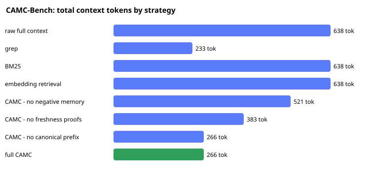

# Benchmarks

All numbers below are produced live by the `memory` binary. Reproduce with `python scripts/benchmark.py` (or the individual commands shown).

> **Honesty:** memory.cpp reduces *prompt-side* tokens and *estimated* KV pressure by sending fewer, fresher, more reusable tokens. It does **not** compress a provider's KV cache. KV figures are estimates from a model profile; runtime TTFT/memory must be measured on a real stack (see `scripts/runtime_bench.md`).

## 1. CAMC-Bench (controlled ablation, synthetic corpus)

`memory bench camc`

| Strategy | Tokens | Cacheable prefix | Reduction vs raw | Stale | Contradictions | Secrets | Task success |
|---|--:|--:|--:|--:|--:|--:|--:|
| raw full context | 638 | 0 | 0.0% | 9 | 9 | 3 | 0/3 |
| grep | 233 | 0 | 63.5% | 3 | 3 | 2 | 0/3 |
| BM25 | 638 | 0 | 0.0% | 9 | 9 | 3 | 0/3 |
| embedding retrieval | 638 | 0 | 0.0% | 9 | 9 | 3 | 0/3 |
| CAMC - no negative memory | 521 | 318 | 18.3% | 0 | 0 | 3 | 3/3 |
| CAMC - no freshness proofs | 383 | 186 | 40.0% | 9 | 9 | 0 | 0/3 |
| CAMC - no canonical prefix | 266 | 0 | 58.3% | 0 | 0 | 0 | 3/3 |
| full CAMC | 266 | 186 | 58.3% | 0 | 0 | 0 | 3/3 |



## 2. Dogfood: memory.cpp on its own repository

memory.cpp seeded with real durable facts about this repo, compiled for real tasks. The naive baseline is the token cost of pasting `README.md, docs/architecture.md, docs/cli.md, docs/cache-aware-compiler.md` into the prompt: **7961 tokens**.

| Task | Raw ctx | Compiled | Reduction | Cacheable prefix | Est. KV avoided |
|---|--:|--:|--:|--:|--:|
| fix the billing export determinism bug | 5307 | 854 | 83.9% | 214 | 554.6 MiB (83.6%) |
| add a new provider pack for a coding agent | 5307 | 850 | 84.0% | 214 | 555.1 MiB (83.7%) |
| review the auth session decision | 5307 | 853 | 83.9% | 214 | 554.5 MiB (83.6%) |

Vs the naive docs paste, the compiled pack for `fix the billing export determinism bug` is **854 tokens** instead of **7961** (**89% smaller**), and its stable prefix is byte-stable and cacheable across tasks.


## 3. Reproduce
```bash
cargo build -p memory-cli
python scripts/benchmark.py        # this file
memory bench camc                  # the ablation table
memory wow --for-acquirer          # one-task summary
```

