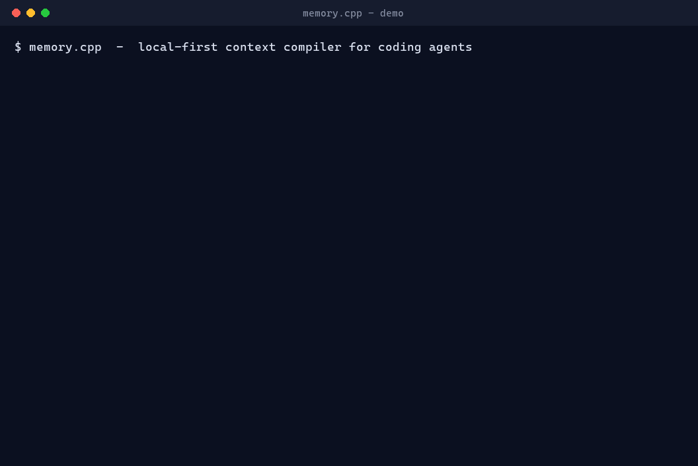

<div align="center">

# memory.cpp

### Cache-aware repo memory for coding agents.

**Remember more. Send less. Cache smarter.**

`memory.cpp` is a **local-first, pre-inference context compiler**. It turns repository
history — decisions, fixes, traces, tests, rules, and prior agent work — into
**freshness-proven, security-filtered, cache-stable context packs** before the model
ever sees the request. Fewer tokens, a larger reusable prefix, stale and harmful
context blocked, and a reproducible record of exactly what was sent.

[](https://github.com/KirtiRamchandani/memory.cpp/actions/workflows/ci.yml)
[](https://github.com/KirtiRamchandani/memory.cpp/actions/workflows/release.yml)
[](LICENSE)
[](#privacy--safety)

[Quick start](#60-second-quickstart) · [Why](#the-problem) · [Compiler](#the-compiler) · [Benchmark](#camc-bench) · [CLI](docs/cli.md) · [Paper](docs/paper/) · [Positioning](docs/competitive-positioning.md)



<sub>Real terminal output (`scripts/render_demo.py` re-records it). Note the two `cache-hash` calls for different tasks return the <strong>same</strong> blake3 prefix hash.</sub>

</div>

---

> **The cheapest token is the one the model never has to process.**

Coding agents are long-horizon: they rebuild tool traces, file summaries, test
output, and repeated intent across many turns. A large prompt can be technically
valid yet still be **wasteful, stale, unsafe, and impossible to cache**. That waste
shows up as repeated prefill work, larger attention state, lower prompt-cache reuse,
more memory pressure per request, and — worst of all — wrong patches when old docs
and prior failed attempts leak into context.

`memory.cpp` treats this as a **compiler problem, not a retrieval problem**. It decides
what belongs in the stable prefix, what belongs in the fresh suffix, what must be
excluded, and what should only be available by rehydration handle.

```text
Raw context available     84,000 tokens
Compiled context           1,420 tokens
Cacheable stable prefix    1,100 tokens   (byte-stable, blake3-hashed)
Stale / secret blocked     ✓ stale  ✓ contradictions  ✓ secrets
Estimated KV avoided       prompt-side — see honesty note below
```

> **Honesty note.** memory.cpp does **not** compress a provider's KV cache. It reduces
> KV *pressure* by keeping unnecessary, stale, duplicated, or harmful tokens out of the
> prompt in the first place. All KV/latency figures are **estimates** unless measured
> against a runtime, and are reported separately from measured numbers.

---

## 60-second quickstart

```bash
# build
cargo build -p memory-cli

# teach it a couple of durable facts
memory remember "Billing exports must be deterministic" --tags invariant
memory remember "ADR-004: use server-side sessions, not JWT"

# compile a cache-stable pack and inspect everything
memory compile "fix the billing export bug" --provider anthropic --budget 1500
memory cache-manifest "fix the billing export bug" --provider anthropic
memory ir inspect "fix the billing export bug"        # typed MemoryIR blocks
memory lock "fix the billing export bug"              # reproducible lockfile + ledger
memory wow --for-acquirer                             # the whole story in one report
```

Install scripts: `./scripts/install.sh` · `./scripts/install.ps1` ·
`cargo install --path crates/memory-cli`

---

## The problem

| Failure mode | What happens in practice | Why it costs a provider |
| --- | --- | --- |
| **Repeated prefill** | The same repo facts, traces, and file summaries are reprocessed every related turn. | More compute before the first output token; higher latency on long prompts. |
| **KV-cache growth** | Every unnecessary input token contributes attention state. | Higher memory pressure → lower concurrency, harder scheduling. |
| **Cache misses** | Stable repo facts are mixed with task text, timestamps, logs, and tool output. | Prompt caching and prefix reuse stop working. |
| **Stale context** | Old decisions and obsolete docs get retrieved because they look relevant. | Wrong patches, repeat loops, lower trust in agent output. |
| **Unmanaged memory** | Memory grows with no proof, lifecycle, or contradiction handling. | Persistent memory becomes a reliability and security risk. |

---

## The compiler

```text
repo / files / git / traces / memories
  → MemoryIR                     typed blocks: source anchor, trust, freshness,
  → optimizer passes             sensitivity, volatility, token cost, cache role
  → stable prefix + fresh suffix durable vs volatile, deterministically separated
  → provider-specific prompt     Anthropic / OpenAI / Gemini / generic
  → cache manifest               cacheable regions + blake3 stable-prefix hash
  → provenance ledger            included / excluded / proofs / hashes
  → optional lockfile            reproducible, auditable context
```

| Layer | Purpose | Result |
| --- | --- | --- |
| **MemoryIR** | A formal IR for repo facts, decisions, traces, tests — each with source anchor, trust, freshness, sensitivity, token cost, and cache role. | Every pack is an explainable compiled artifact, not a loose bundle of text. |
| **Stable prefix + fresh suffix** | Durable repo knowledge is separated from volatile task state, logs, and errors. The stable prefix excludes task text and is `blake3`-hashed. | Same repo state → same prefix across tasks → real prompt-cache reuse. |
| **Negative memory** | Stale docs, wrong fixes, generated files, misleading traces, and superseded decisions are remembered as *exclusions*. | The model gets less harmful context, not just more context. |
| **Freshness proofs** | Memories are tied to source files, hashes, commits, tests, or human confirmation. | Old or unsupported memories are rejected before they enter the prompt. |
| **KV-aware optimizer** | Context is scored by `utility / cost`, where cost includes tokens and volatility — not relevance alone. | Small high-signal facts beat large weakly-useful files. |
| **Rehydratable handles** | Packs can ship compact facts plus `mem://file/...#L10-L50` handles. | Exact code is loaded only when needed; tiny upfront token load. |
| **Ledger + lockfile** | Every pack records included/excluded memory, proof state, cache regions, and hashes. | Agent context becomes reproducible and auditable. |

---

## CAMC-Bench

`memory bench camc` runs **CAMC-Bench** (Cache-Aware Memory Compilation) — a
deterministic comparison of selection strategies on a bundled synthetic corpus.
Every number is produced by the real compiler code paths (run it yourself):

### CAMC-Bench (synthetic corpus, model llama-3.1-8b, budget 1500)

| Strategy | Tokens | Cacheable prefix | Reduction vs raw | Stale | Contradictions | Secrets | Task success |
|---|--:|--:|--:|--:|--:|--:|--:|
| raw full context | 638 | 0 | 0.0% | 9 | 9 | 3 | 0/3 |
| grep | 233 | 0 | 63.5% | 3 | 3 | 2 | 0/3 |
| BM25 | 638 | 0 | 0.0% | 9 | 9 | 3 | 0/3 |
| embedding retrieval | 638 | 0 | 0.0% | 9 | 9 | 3 | 0/3 |
| CAMC − no negative memory | 521 | 318 | 18.3% | 0 | 0 | 3 | 3/3 |
| CAMC − no freshness proofs | 383 | 186 | 40.0% | 9 | 9 | 0 | 0/3 |
| CAMC − no canonical prefix | 266 | 0 | 58.3% | 0 | 0 | 0 | 3/3 |
| **full CAMC** | **266** | **186** | **58.3%** | **0** | **0** | **0** | **3/3** |

Read it as an ablation: raw/BM25/embedding leak 9 stale memories, 9 contradictions,
and 3 secrets and **fail the task oracle**; removing freshness proofs reintroduces
stale/contradictions; removing the canonical prefix loses all cacheable tokens;
removing negative memory leaks secrets. **Full CAMC** sends the fewest tokens, keeps
a cacheable prefix, blocks every unsafe block, and preserves task success.

> Synthetic corpus — it measures the *mechanism*, not real-world win rates. Real-repo
> and runtime numbers must come from live measurement. Reproduce: `memory bench camc`.

### Dogfooded on this repo

Seeded with real durable facts about memory.cpp and compiled for real tasks, the
compiled pack is **854 tokens vs 7,961** for the naive "paste the docs" baseline
(`README.md` + `docs/architecture.md` + `docs/cli.md` + `docs/cache-aware-compiler.md`)
— **~89% smaller**, with a byte-stable cacheable prefix that is *identical across
tasks*. Full numbers, charts, and the reproduce command: **[BENCHMARKS.md](BENCHMARKS.md)**.

For **measured** (not estimated) TTFT and prefix-cache benefit against vLLM / llama.cpp /
Ollama / SGLang, run [`scripts/runtime_bench.py`](scripts/runtime_bench.md).

---

## What you can run today

| Area | Commands |
| --- | --- |
| **Compile** | `compile` · `cache-manifest` · `cache-hash` · `ir inspect` · `optimize --objective kv_efficiency \| -O3 \| -Oz` |
| **Freshness & safety** | `prove` · `audit-stale` · `negative add/list/explain` · `explain-exclusions` · `write-firewall` · `poison` |
| **Cost & cache** | `tokens --provider …` · `kv-sim --model llama-3.1-8b` · `cache-plan` · `kv-report` |
| **Reproducibility** | `lock` · `lock diff` · `reproduce` · `ledger latest/show/export` · `verify-pack` |
| **Self-healing** | `gc --apply` · `contradictions scan/resolve` · `merge --prefer-newer` |
| **Governance** | `invariants extract` · `contract add/check` · `ci-check --require-rules` (PR gate) |
| **Distribution** | `autolearn` · `mcp install --client claude` · `multi-agent-plan` · `view --agent security` |
| **Research** | `minimize --must-include …` · `autopsy` · `fuzz-context` · `debt` · `bench camc` · `paper run` |
| **Memory vault** | `remember` · `recall` · `ask` · `inbox review` · `entity` · `session` · `insight` |
| **Provider packs** | `pack --for claude\|codex\|gemini\|cursor\|continue\|mcp` · `attach` · `agents-score` |

Full reference: [docs/cli.md](docs/cli.md). API/SDK surface: [docs/api.md](docs/api.md).

---

## How it differs from memory products

Most memory systems optimize **storage and retrieval**. memory.cpp focuses on what
happens **after retrieval but before inference**: compilation, cache layout,
exclusion, proof, and measurement.

| System | Primary role | memory.cpp difference |
| --- | --- | --- |
| Supermemory | Broad cloud context + retrieval for agents | Local-first, repo-specific, compiler-oriented: cache layout, stale exclusion, prefix stability, measurement |
| Mem0 | Persistent cross-session/agent memory | Repository context *compilation*, source-anchored freshness, negative memory, KV-aware packing |
| Honcho | Stateful agent/entity memory | Deterministic local reports, MemoryIR, cache manifests, freshness proofs, reproducible ledgers |
| Vector DB / RAG | Top-k similarity retrieval | Not top-k: a compiler that excludes, proves, and cache-optimizes the minimal sufficient context |
| Provider prompt caching | Runtime prefix reuse | memory.cpp *produces* the byte-stable prefix that makes prompt caching actually hit |

Full table: [docs/competitive-positioning.md](docs/competitive-positioning.md).

---

## Privacy & safety

Local-first by default — a SQLite vault under `.memory.cpp/`. **No cloud, no
accounts, no telemetry, no network calls** unless you explicitly enable a connector.
Secrets are redacted, prompt-injection patterns are quarantined, and the **write
firewall** screens risky memory *before* it is ever stored. MCP exposes **read-only**
resources by default. See [SECURITY.md](SECURITY.md) and [docs/safety.md](docs/safety.md).

---

## Develop & validate

```bash
cargo fmt --all -- --check
cargo clippy --workspace --all-targets -- -D warnings
cargo test --workspace
cargo build -p memory-cli
```

CI runs on Linux, macOS, and Windows. The core compiler lives in
[`crates/memory-core`](crates/memory-core/src) (`ir`, `prefix`, `cache_manifest`,
`freshness`, `negative`, `optimizer`, `tokenizer`, `kv_model`, `ledger`, `lockfile`,
`minimize`, `rehydrate`, `autopsy`, `fuzz`, `poison`, `debt`, `bench`).

---

<div align="center">

MIT © [KirtiRamchandani](https://github.com/KirtiRamchandani)

**memory.cpp — long-horizon agents need a context compiler, not just a bigger memory store.**

</div>
